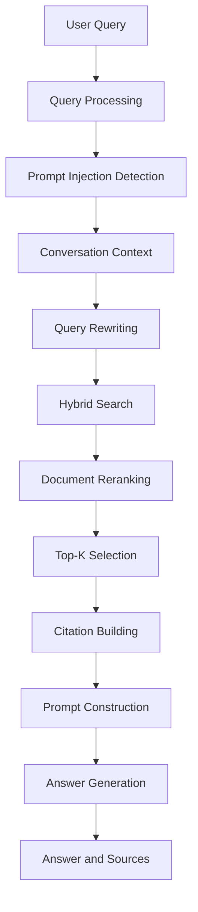

# egyptian-legal-rag

An intelligent RAG-based assistant for Egyptian legal information, providing accurate answers from trusted sources.

## Supported Domains

- Social Insurance & Pensions
- Labour Law
- Tax Law
- Companies Law
- Civil Service Law
- Customs Law
- Reconciliation of Building Violations


## Requirements

* Python 3.11 or later
* [uv](https://docs.astral.sh/uv/)

## How It Works

The system uses a conversational Retrieval-Augmented Generation (RAG) pipeline to retrieve relevant Egyptian legal documents and generate context-aware answers grounded in legal sources.

### RAG Pipeline



### Pipeline Stages

1. **Query Processing:** Processes the user's question and incorporates relevant visual information when an image is provided.

2. **Prompt Injection Detection:** Checks the processed query for potential prompt injection attempts before continuing.

3. **Conversation Context:** Loads previous messages and the existing conversation summary to understand follow-up questions.

4. **Query Rewriting:** Reformulates unclear or context-dependent questions using the conversation history and previous summary to improve retrieval quality.

   **Example:**

   Original query:

   > أنا كنت شغال وبعدين حصل موضوع في الشغل ومش عارف آخد حقي إزاي، أعمل إيه؟

   If the conversation indicates that the employer terminated the contract without paying the employee's outstanding wages, the rewritten query could be:

   > ما حقوق العامل في مصر عند انتهاء علاقة العمل وعدم حصوله على الأجور المستحقة، وما الإجراءات القانونية للمطالبة بها؟

   The rewritten query uses the available context to make the search more specific without assuming details that the user has not provided.

5. **Hybrid Search:** Retrieves candidate legal passages using the configured hybrid retrieval strategy.

6. **Document Reranking:** Reorders the retrieved passages according to their relevance to the rewritten query.

7. **Top-K Selection:** Selects the highest-ranked documents to provide focused legal context for answer generation.

8. **Citation Building:** Extracts available source information, page numbers, and document links from the selected passages.

9. **Prompt Construction:** Combines the retrieved legal passages, their metadata, and the user's question into the generation prompt.

10. **Answer Generation:** Generates a response using the selected legal context and available conversation history.

11. **Answer and Sources:** Returns the generated answer, retrieved documents, applied filters, and available citations.

If no relevant documents are retrieved, the system returns a predefined no-answer response instead of proceeding with answer generation.

### Why This Approach?

Combining conversation-aware query rewriting, hybrid retrieval, and reranking helps improve the relevance of the legal evidence provided to the language model. Selecting the top-ranked passages controls the generation context, while citations help users trace answers back to their legal sources.


## Installation

### Install uv

If you don't have `uv` installed, install it using:

```bash
curl -LsSf https://astral.sh/uv/install.sh | sh
```

Then verify the installation:

```bash
uv --version
```

### Clone the repository

```bash
git clone https://github.com/Ahmed-KKhaled/egyptian-legal-rag.git
cd egyptian-legal-rag
```

### Create the virtual environment and install dependencies

```bash
uv sync
```

This will create the project's virtual environment and install all dependencies specified in `pyproject.toml`.

### Activate the virtual environment

You can activate the environment manually:

```bash
source .venv/bin/activate
```

Or simply run project commands through `uv` without activating the environment:

```bash
uv run <command>
```

### Setup your command line interface for better readability

```bash
export PS1="\\[\033[01;32m\\]\u@\h:\w\n\\[\033[00m\\]\\$ "
```

## Environment Variables

Copy the example environment file:

```bash
cp .env.example .env
```

Set your environment variables in the `.env` file, such as:

```env
OPENAI_API_KEY=your_api_key
```

## Run Docker Compose Services

```bash
cd docker
cp .env.example .env
```

Update `.env` with your credentials.

Then start the Docker Compose services:

```bash
sudo docker compose up -d
```

## Run the FastAPI Server

From the `src` directory:

```bash
cd src
uv run uvicorn main:app --reload --host 0.0.0.0 --port 5000
```

The API will be available at:

```text
http://localhost:5000
```

## Run the Frontend

Make sure Node.js and npm are installed:

```bash
node --version
npm --version
```

Navigate to the frontend directory:

```bash
cd frontend
```

Install the dependencies:

```bash
npm install
```

Start the development server:

```bash
npm run dev
```

The frontend will be available at the local URL displayed in your terminal, usually:

```text
http://localhost:5173
```

Make sure the FastAPI server is running before using the frontend. The frontend must also be configured to connect to the correct backend API URL.

Swagger API documentation:

```text
http://localhost:5000/docs
```
