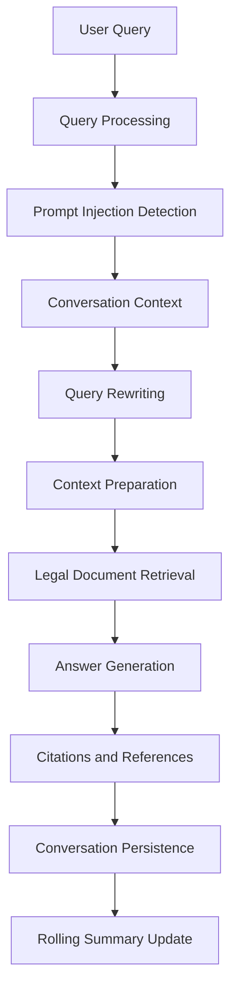

# egyptian-legal-rag

An intelligent RAG-based assistant for Egyptian legal information, providing accurate answers from trusted sources.

## Supported Domains

- Social Insurance & Pensions
- Labour Law
- Tax Law
- Companies Law
- Civil Service Law
- Customs Law
- Reconciliation of Building Violations


## Requirements

* Python 3.11 or later
* [uv](https://docs.astral.sh/uv/)

## How It Works

The system follows a conversational Retrieval-Augmented Generation (RAG) pipeline that transforms user queries into context-aware answers grounded in relevant Egyptian legal documents.

### RAG Pipeline



### Pipeline Stages Explained

Suppose an Egyptian citizen wants to ask about a legal issue but submits an unclear question:

**Original query:**

> أنا كنت شغال وبعدين حصل موضوع في الشغل ومش عارف آخد حقي إزاي، أعمل إيه؟

**1. User Query**

The system receives the user's question and any optional image or geographic information.

At this stage, the original query is preserved as the user's actual message.

**2. Query Processing**

The system prepares the question for downstream processing. If an image is provided, relevant visual information can be incorporated into the query.

In this example, no image is provided, so the system processes the text question.

**3. Prompt Injection Detection**

The system checks whether the processed query contains a potential prompt injection attempt.

The example question is an ordinary legal inquiry, so it can continue through the pipeline.

**4. Conversation Context**

The system loads previous messages and the existing conversation summary, if available.

If the user previously mentioned that their employer terminated their contract without paying their outstanding wages, this information can help clarify what they mean by "مش عارف آخد حقي".

**5. Query Rewriting**

The system uses the original question, conversation history, and previous summary to reformulate the query into a clearer search request.

For example, if the conversation indicates that the issue concerns unpaid wages after termination, the rewritten query might be:

> ما حقوق العامل في مصر عند انتهاء علاقة العمل وعدم حصوله على الأجور المستحقة، وما الإجراءات القانونية للمطالبة بها؟

The rewritten query is contextual, not an assumption that should be made without supporting information from the conversation.

**6. Context Preparation**

The system prepares the project configuration, conversation history, and retrieval settings for the RAG agent.

This determines the context and limits available to the retrieval workflow.

**7. Legal Document Retrieval**

The system searches the legal knowledge base for relevant Egyptian labour-law provisions concerning unpaid wages and termination of employment.

The retrieved passages provide the legal context used in the next stage.

**8. Answer Generation**

The language model generates a response based on the retrieved legal documents.

The answer should explain the relevant legal provisions and practical next steps without inventing legal information that is not supported by the available context.

**9. Citations and References**

The system collects available citations and source metadata so the user can verify the legal provisions supporting the answer.

**10. Conversation Persistence**

When an answer is available, the user's original question and the assistant's response are saved to the conversation history.

This allows subsequent questions to use the earlier discussion as context.

**11. Rolling Summary Update**

Periodically, the system summarizes recent conversation messages together with the previous summary and saves the updated summary.

This helps preserve important details for future questions without relying exclusively on the full conversation history.

### Key Benefit

The pipeline helps transform vague or context-dependent questions into more useful legal search queries while preserving conversation context and grounding generated answers in retrieved legal sources.

The quality of the final answer depends on the available conversation context, retrieval quality, and relevance of the legal documents in the knowledge base.


## Installation

### Install uv

If you don't have `uv` installed, install it using:

```bash
curl -LsSf https://astral.sh/uv/install.sh | sh
```

Then verify the installation:

```bash
uv --version
```

### Clone the repository

```bash
git clone https://github.com/Ahmed-KKhaled/egyptian-legal-rag.git
cd egyptian-legal-rag
```

### Create the virtual environment and install dependencies

```bash
uv sync
```

This will create the project's virtual environment and install all dependencies specified in `pyproject.toml`.

### Activate the virtual environment

You can activate the environment manually:

```bash
source .venv/bin/activate
```

Or simply run project commands through `uv` without activating the environment:

```bash
uv run <command>
```

### Setup your command line interface for better readability

```bash
export PS1="\\[\033[01;32m\\]\u@\h:\w\n\\[\033[00m\\]\\$ "
```

## Environment Variables

Copy the example environment file:

```bash
cp .env.example .env
```

Set your environment variables in the `.env` file, such as:

```env
OPENAI_API_KEY=your_api_key
```

## Run Docker Compose Services

```bash
cd docker
cp .env.example .env
```

Update `.env` with your credentials.

Then start the Docker Compose services:

```bash
sudo docker compose up -d
```

## Run the FastAPI Server

From the `src` directory:

```bash
cd src
uv run uvicorn main:app --reload --host 0.0.0.0 --port 5000
```

The API will be available at:

```text
http://localhost:5000
```

## Run the Frontend

Make sure Node.js and npm are installed:

```bash
node --version
npm --version
```

Navigate to the frontend directory:

```bash
cd frontend
```

Install the dependencies:

```bash
npm install
```

Start the development server:

```bash
npm run dev
```

The frontend will be available at the local URL displayed in your terminal, usually:

```text
http://localhost:5173
```

Make sure the FastAPI server is running before using the frontend. The frontend must also be configured to connect to the correct backend API URL.

Swagger API documentation:

```text
http://localhost:5000/docs
```
